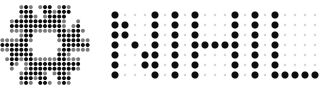
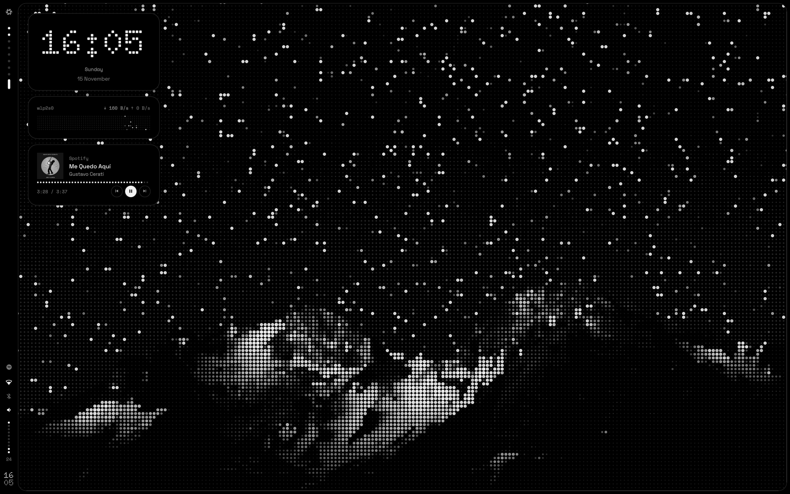
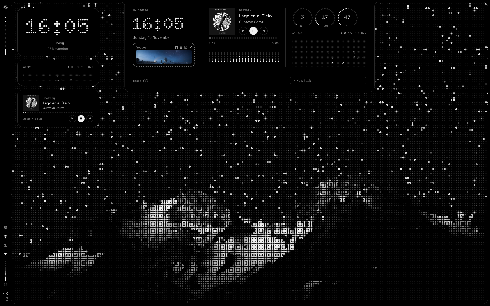
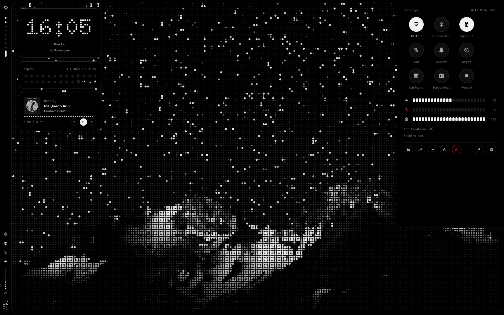
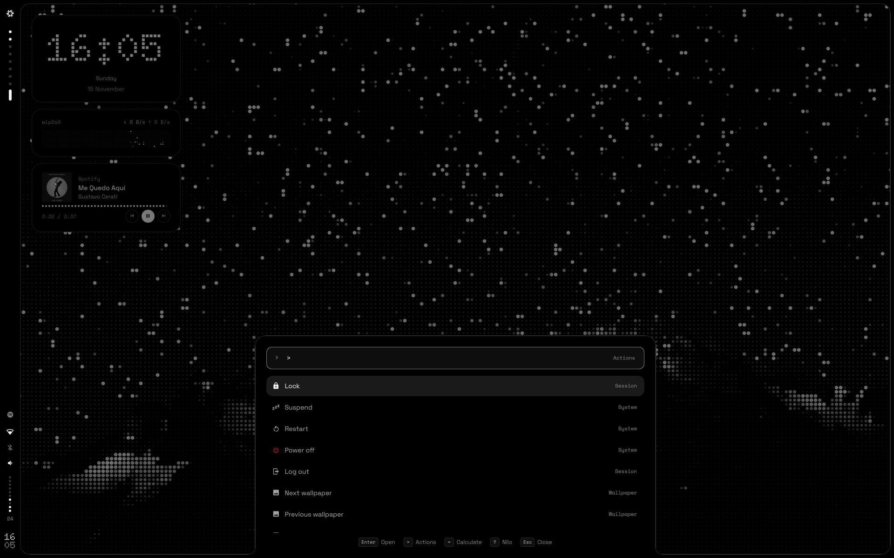
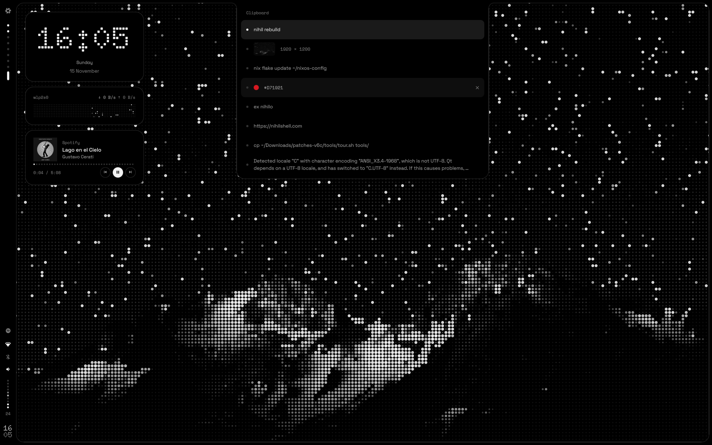
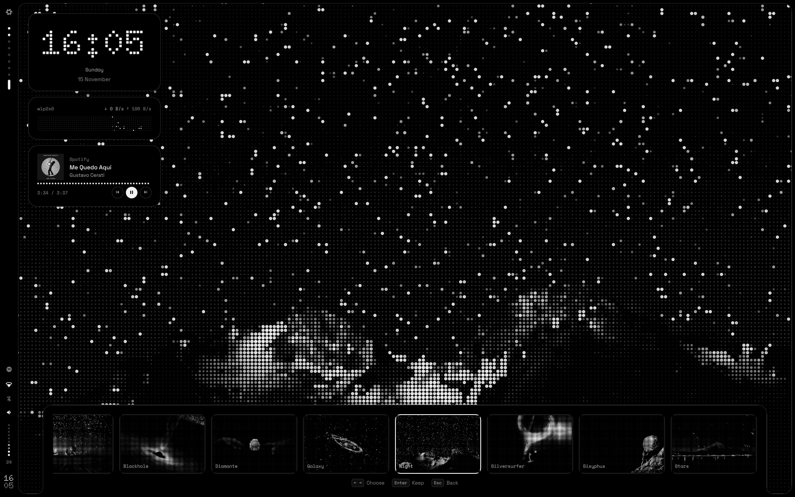
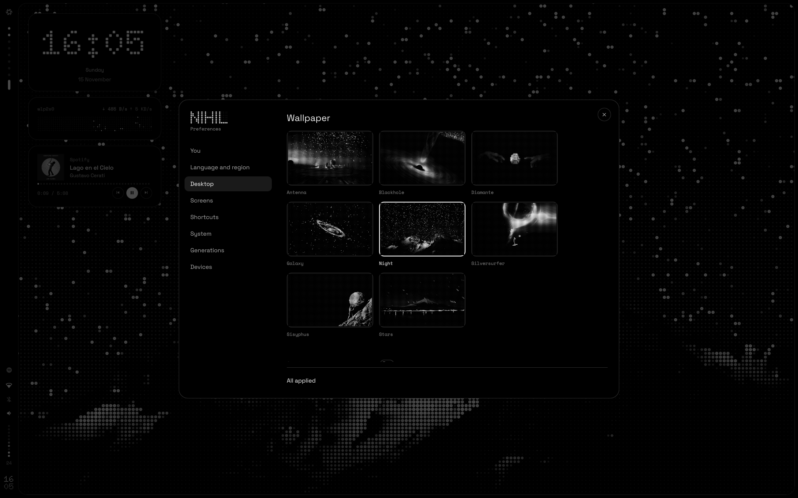
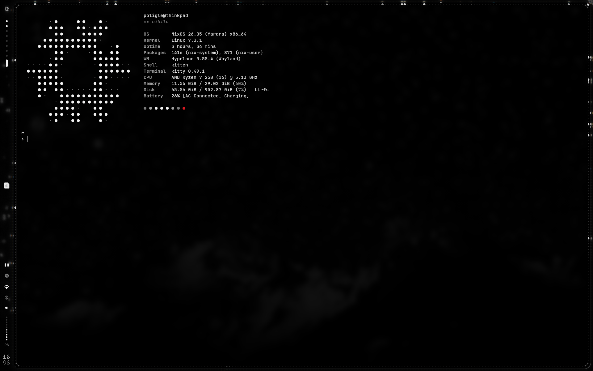

  <picture>
    <source media="(prefers-color-scheme: dark)" srcset="assets/brand/nihil-logo-dark.svg">
    
  </picture>

<i>ex nihilo</i>

A monochrome, dot-matrix desktop for NixOS

  <a href="https://nihilshell.com/">Website</a> &nbsp;&nbsp;&nbsp;
  <a href="docs/install.md">Install</a> &nbsp;&nbsp;&nbsp;
  <a href="https://github.com/poligle/Nihil-Launcher">Launcher for Android</a> &nbsp;&nbsp;&nbsp;
  <a href="https://github.com/poligle/Nihil-Wear">Watch for Wear OS</a>

NIHIL is a personal NixOS configuration. It takes the structure of
[Caelestia](https://github.com/caelestia-dots/shell), a frame around the screen with
drawers that grow out of it, and dresses it in the language of Nothing: monochrome,
dot-matrix type, red only to interrupt, and light that runs along the edge. All of it is
declared in Nix, and one file, [`theme/nihil.nix`](theme/nihil.nix), holds the tokens that
GTK, the terminal, the compositor, the lock screen and the shell are made from.

> *Nihil* is Latin for "nothing", the way *caelestia* is Latin for "the heavenly". And
> *ex nihilo*, from nothing, is also what NixOS does: the whole system, rebuilt from a
> declaration.

| | |
|:---:|:---:|
|  |  |
| Dashboard <kbd>SUPER</kbd> <kbd>D</kbd> | Quick settings <kbd>SUPER</kbd> <kbd>P</kbd> |
|  |  |
| Launcher <kbd>SUPER</kbd> <kbd>Space</kbd> | Clipboard history, holding <kbd>SUPER</kbd> <kbd>V</kbd> |
|  |  |
| Wallpapers in dots <kbd>SUPER</kbd> <kbd>W</kbd> | Preferences <kbd>SUPER</kbd> <kbd>O</kbd> |

  

The same, in smoked glass: one switch in Preferences.

## What's in it

- **The frame and its drawers.** One black shape around the screen; the bar is its left
  side, and the dashboard, quick settings and the launcher grow out of it.
- **Smoked glass,** if you choose it: the frame and every drawer turn to dark glass over
  what is really behind them.
- **Nilo,** an assistant with a model that runs here, and as much of the system as you
  give it: a chat, a repository, or the whole desktop.
- **The phone and the watch as decks,** with [NIHIL Launcher](https://github.com/poligle/Nihil-Launcher)
  and [NIHIL for Wear OS](https://github.com/poligle/Nihil-Wear), and Vector to carry
  things between them and this computer.
- **Preferences,** the whole system on one sheet, applied as a rebuild, with every
  generation a click away.
- **Wallpapers in dots,** its own sounds, and the boot splash, greeter and lock screen in
  the same language.
- **An installer** that makes room next to Windows, or takes a whole disk.

## Learn more

- [Everything in it, in detail](docs/features.md)
- [Install, and keep it current](docs/install.md)
- [Keys, commands and options](docs/reference.md)
- [Nilo](docs/nilo.md)
- [The phone as a deck](docs/phone.md), and [its protocol](docs/deck.md)
- [Design](docs/design.md)
- [Inside NIHIL](docs/inside.md)

## Credits

- [Caelestia](https://github.com/caelestia-dots/shell) for the frame-and-drawers idea.
- [Nothing](https://nothing.tech) for the design language that inspired the look. NIHIL
  is a personal project and is not affiliated with Nothing Technology.
- [Quickshell](https://quickshell.org), [Hyprland](https://hyprland.org),
  [Stylix](https://github.com/nix-community/stylix) and
  [Home Manager](https://github.com/nix-community/home-manager).
- The NixOS snowflake (by Tim Cuthbertson, CC BY 4.0) is drawn as LEDs from the
  Material Design Icons glyph shipped with Nerd Fonts.
- Fonts: Doto, Space Grotesk and Space Mono (SIL OFL 1.1), JetBrains Mono (SIL OFL 1.1).
  The website ships subsets of the first three, with their licence in `docs/assets/fonts`.
- Icons: [Colloid](https://github.com/vinceliuice/Colloid-icon-theme) by Vince Liuice
  (GPL-3.0), installed from nixpkgs.

Code, sounds and brand assets in this repository are MIT licensed (see `LICENSE`).

## Notes

Public repository: contains no secrets or credentials. User passwords are set with
`passwd`, and SSH keys and fingerprint data live outside the repository.
