<p align="center">
  <picture>
    <source media="(prefers-color-scheme: dark)" srcset="assets/brand/nihil-logo-dark.svg">
    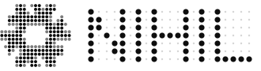
  </picture>
</p>

<p align="center"><i>ex nihilo</i></p>

<p align="center">A monochrome, dot-matrix desktop for NixOS</p>

<p align="center">
  <a href="https://nihilshell.com/">Website</a> &nbsp;&nbsp;&nbsp;
  <a href="#install">Install</a> &nbsp;&nbsp;&nbsp;
  <a href="#options">Options</a> &nbsp;&nbsp;&nbsp;
  <a href="#keybindings">Keybindings</a> &nbsp;&nbsp;&nbsp;
  <a href="https://github.com/poligle/Nihil-Launcher">Launcher for Android</a> &nbsp;&nbsp;&nbsp;
  <a href="https://github.com/poligle/Nihil-Wear">Watch for Wear OS</a>
</p>


NIHIL is a personal NixOS configuration. It takes the structure of
[Caelestia](https://github.com/caelestia-dots/shell) — a frame around the screen with
drawers that grow out of it — and dresses it in the language of Nothing: monochrome,
dot-matrix type, red only to interrupt, and light that runs along the edge.

Everything is declarative: Flakes, Home Manager, Stylix and a shell written from scratch
in [Quickshell](https://quickshell.org). One file, [`theme/nihil.nix`](theme/nihil.nix),
holds the design tokens, and every layer — GTK, terminal, editor, compositor, lock
screen, greeter, boot splash and the shell — is generated from it.

> *Nihil* is Latin for "nothing", the way *caelestia* is Latin for "the heavenly". And
> *ex nihilo*, from nothing, is also what NixOS does: the whole system, rebuilt from a
> declaration.

**On the phone, too:** [NIHIL for Android](https://github.com/poligle/Nihil-Launcher) is a
home screen in the same language: the frame, the desktop's clock, its light and its launcher, and the phone as a deck for this computer ([nihilshell.com/android](https://nihilshell.com/android/)).

---

## Highlights

- **Frame and bar.** One black shape around every screen. Its left side widens into the
  bar: NixOS mark, workspaces as LEDs, the active app, tray, status, a 10-LED battery
  gauge, the clock in dots and a red privacy LED while something records the mic.
- **Drawers.** The dashboard, the settings panel and the launcher are bumps of the frame
  itself, with concave joints, so they look like part of the hardware.
- **Dashboard.** Time, music with the cover rendered as a dot matrix and a spectrum in
  LED columns, CPU/RAM/temperature dials, a network oscilloscope, a kanban (to do, doing,
  done: drag a card where it goes, its pencil writes it again, a broom clears the done ones)
  and caffeine, which keeps the screen from dimming, locking or sleeping.
- **Settings.** Circular toggles, segmented sliders, Wi-Fi (with passwords and
  WPA-Enterprise hand-off), Bluetooth, audio output, notification history, session.
- **Preferences.** Your name and password, language, keyboard and time zone, wallpaper
  and desktop widgets, the screens, shortcuts and programs, the computer's name, Nilo,
  the clipboard history, the boot sound, fingerprint and SSH, in one sheet (`SUPER + O`) that the first login opens as a welcome. The wallpaper,
  the widgets and the password change at once; the rest waits until applied, and applying
  rebuilds the system in the background.
- **Generations, from Preferences.** Every rebuild is a whole system NixOS keeps. Each one
  says when it was made, its NixOS, kernel and NIHIL, and which packages it changed;
  one click goes back to it, now and at boot, or boots it just once. How long they stay,
  and cleaning now, with what it frees.
- **The phone as a deck.** With [NIHIL Launcher](https://github.com/poligle/Nihil-Launcher) on Android, paired with a QR
  from Preferences, the phone opens the computer's apps and web pages, plays and skips
  its music, turns its volume, locks it and is its trackpad, with this desktop's gestures;
  the dashboard's kanban stays in sync with it. Over HTTPS pinned to this computer. See
  [The phone as a deck](#the-phone-as-a-deck).
- **An installer.** An ISO that installs NIHIL on a whole disk, or next to Windows or
  another Linux in room it makes by shrinking it safely. See [Install](#install).
- **Launcher.** Monochrome app grid that regains colour on the selection, `>` for
  actions, `=` for a calculator, `?` for Nilo.
- **Copy, paste and the clipboard history.** One modifier for both, as on a Mac: `SUPER + C`
  copies and `SUPER + V` pastes, in kitty too. Held a moment longer, `SUPER + V`
  brings out the last copies, text and pictures, from the top of the frame: `V` again goes
  to the next one, and letting go of `SUPER` pastes it where you were (`Esc`: none). The
  window keeps the keyboard all along, so what was open in it stays open. The one chosen
  is lit, its picture in colour. What a password manager copies is never kept.
- **Nilo.** An optional assistant with a local model (Qwen 3.5 on Ollama): two white eyes
  that wake up while you type, answer, search the web if you let them and open apps. Asking
  you first, they change files, commit and push in a repository of yours and run commands.
  Close the launcher mid-answer and they tell you when they're done, from the bar. It falls
  asleep and frees the memory after a few minutes. See [Nilo](#nilo).
- **Light on the edge.** In the spirit of Nothing's Glyph Interface, every notification
  sends a segment of light around the frame; critical ones run twice, in red, like the
  battery warnings at 15, 10 and 5 %. Plugging in the charger sends two lights up both
  sides from the bottom, which meet at the top, like the launcher on the phone. Work
  that takes a while stays on it: a rebuild (Preferences, updating, a generation) keeps
  the two lights as far up as it has got and rises when it is done; a download in Zen,
  Firefox or Chromium sends a faint stretch round until it ends. Anything else can use
  it too: `nihil-ipc glyph progress <id> <0..1>`, then `done <id>`.
- **Wallpapers as LED matrices.** Every picture in `wallpapers/`, and in a machine's
  `/etc/nixos/wallpapers` (PNG, JPEG, GIF or WebP, with any name), is rendered at build
  time as dots, once per output at its native size, so each dot lands on exact pixels. A
  GIF moves on the desktop. Each picture on each screen is drawn once and kept: a rebuild
  only draws the new ones. The [studio](https://nihilshell.com/studio/) does the same in
  the browser with any picture, moving ones too (`docs/studio/`, the same numbers as
  `theme/dotmatrix.py`).
- **Boot, login, lock.** The NixOS snowflake switching on LED by LED (Plymouth, played
  whole at least once on the way up and on the way down) with the power-off notes going
  up, unless the session was left muted, a greeter with the lock screen's face (its
  own, in Quickshell: the time in dots, the password as dots, a finger or the password) and
  a lock screen with what is playing in a corner: the cover in dots, the progress in LEDs
  and buttons you can click (hyprlock).
- **fastfetch in dots.** The same snowflake, drawn with `●` and `·`, monochrome keys in
  NIHIL's own greys and the palette as a row of LEDs.
- **Spanish or English.** One option switches every string of the shell, the lock screen,
  the greeter and the scripts, and the language of their dates.
- **Its own sound.** A set of short digital blips, synthesised by
  [`tools/sounds.py`](tools/sounds.py); the previous sounds are one option away.

| | |
|:---:|:---:|
| 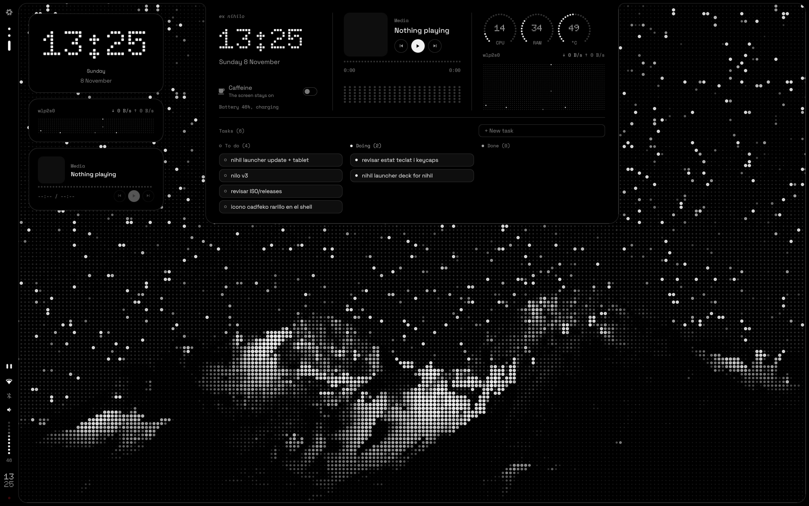 | 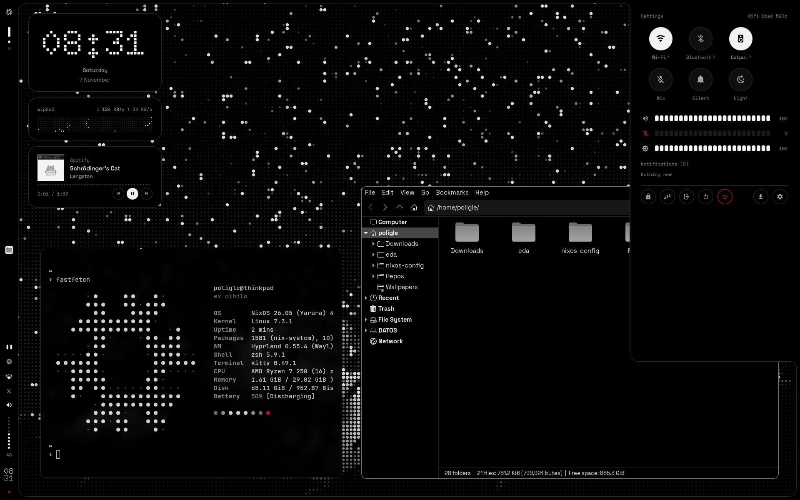 |
| Dashboard — hover the top edge or `SUPER + D` | Quick settings — `SUPER + P`, the status icons or the top-right corner |
| 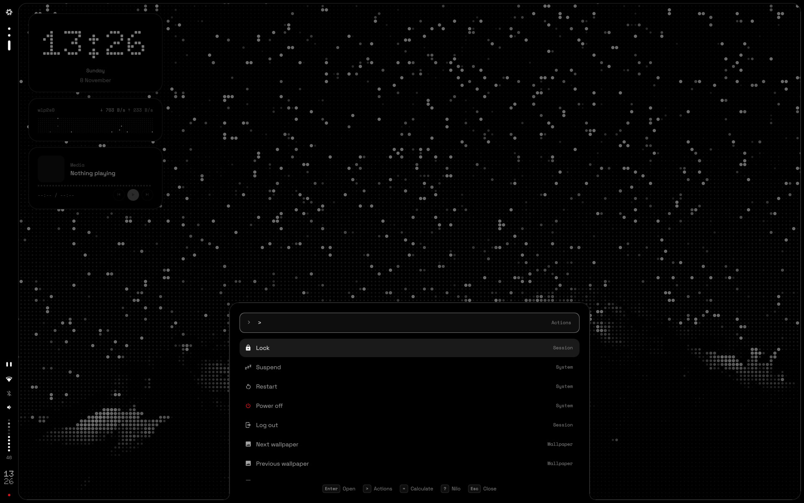 | 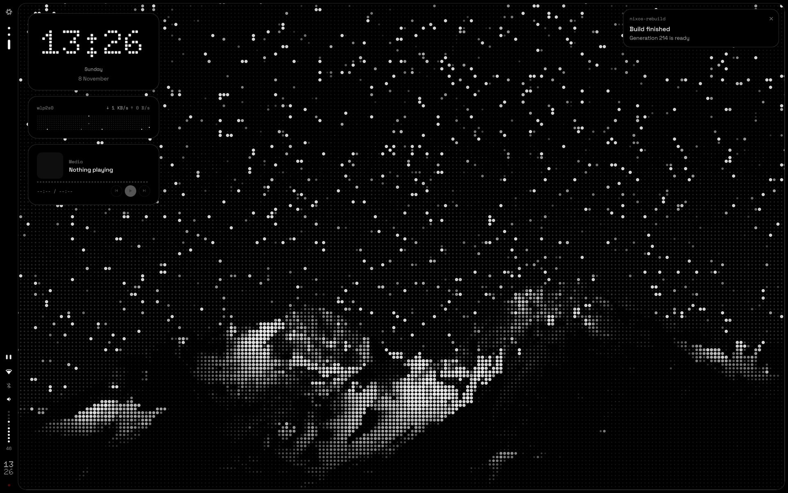 |
| Launcher, its actions — `SUPER + Space`, three fingers up or the bottom edge | A notification, and its light around the frame |
| 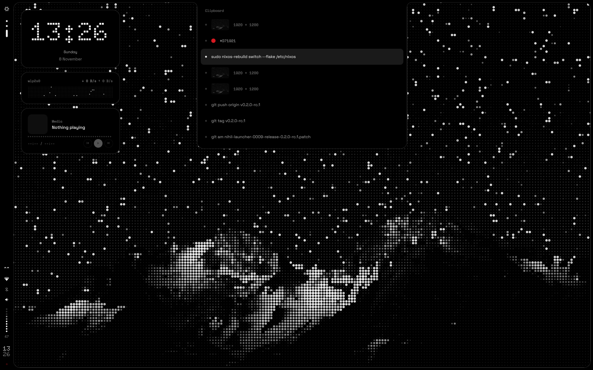 | 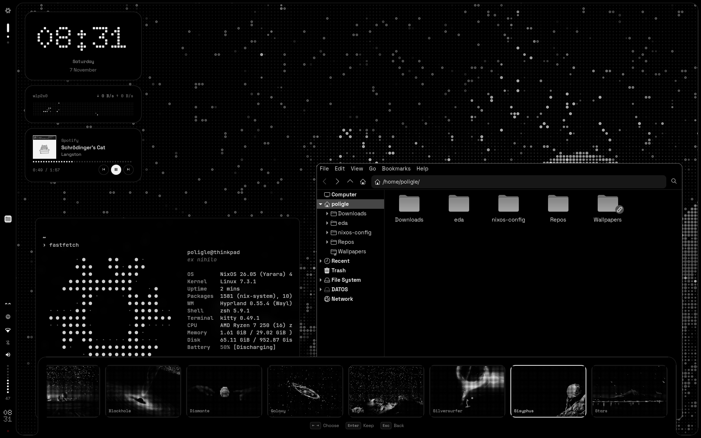 |
| Clipboard history — hold `SUPER + V` | Wallpapers in dots — `SUPER + W` |
| 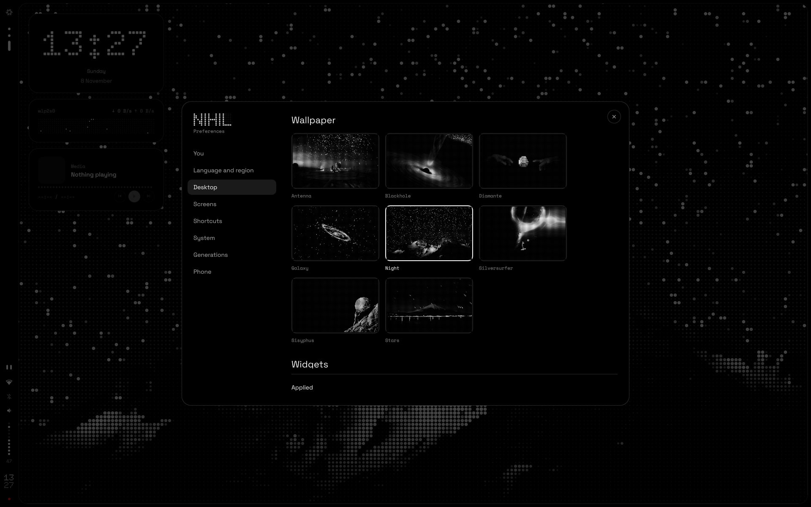 | 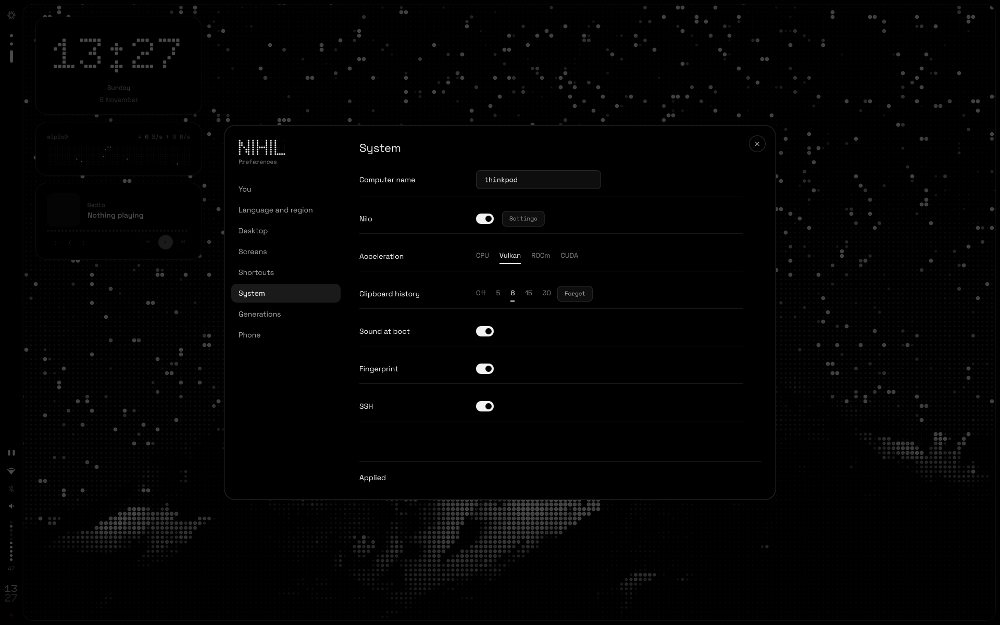 |
| Preferences — `SUPER + O` or the cog | The system, applied as a rebuild |

<sub>NIHIL at 1920 × 1200. App icons are Colloid's.</sub>

---

## Design language

Three rules come before everything else:

1. **Hierarchy is made with greys.** Red is never decoration: it only interrupts — a
   failed login, a critical notification, the recording LED, a destructive action — and
   it is never small text: what went wrong is said in ink, with a red LED before it.
2. **Dots are for display.** Doto draws the clock and the big numbers; text stays in
   Space Grotesk, labels in Space Mono. All of it in sentence case: a capital to start,
   and proper names their own (no lowercase-only lines, no capitals-only ones).
3. **The frame is hardware.** Opaque, flat, no shadows; windows sit concentric with it.

| Token     | Hex       | Use                                   |
|-----------|-----------|---------------------------------------|
| `void`    | `#000000` | Frame, bar, drawers                   |
| `surface` | `#0E0E0E` | Cards inside drawers                  |
| `raised`  | `#1A1A1A` | Hover, slider tracks                  |
| `line`    | `#2A2A2A` | 1 px lines                            |
| `off`     | `#333333` | LEDs that are off                     |
| `muted`   | `#7A7A7A` | Metadata, inactive icons (4.89:1)     |
| `dim`     | `#A3A3A3` | Secondary text (8.33:1)               |
| `ink`     | `#F2F2F2` | Primary text, lit LEDs (18.76:1)      |
| `signal`  | `#D71921` | Interrupts only, never small text     |

Contrast ratios are against `#000000`. Fonts: [Doto](https://github.com/oliverlalan/Doto),
[Space Grotesk](https://github.com/floriankarsten/space-grotesk) and Space Mono (all SIL
OFL 1.1), plus JetBrains Mono Nerd Font for the terminal and glyphs. Icons: Colloid in
its grey variant; the shell shows app icons desaturated.

**Smoked glass**, off unless chosen in Preferences, Look: the frame, its drawers and every
card, key, tab, row and field in them, Preferences, the desktop's widgets, the lock
screen's field and the login's become dark glass. Behind it is what is really there: the
wallpaper (the output's own render, dot for dot) and, wherever glass can be over one, the
windows, captured live where they are (a drawer out, a notification, a window dragged
under the frame, Preferences). A third of it comes through the smoke. The bevel is clear
and bends it outwards, its colours a little apart where it bends most; the face beyond is
frosted and a little uneven, so the dots come through soft and their light spreads past
them, and the edge glows where something bright is near it; a glint where the light from
the top left catches the edge. Light surfaces (ink, red) frost more, so what is on them
keeps its contrast; the hairlines become the glass's own edges, and a border that says
something (focus, the one chosen, an error) stays. The shell draws it with two shaders
(`home/shell/shaders/`) over one texture of what is behind, with its mipmaps for the
frost (`components/Backdrop.qml`); hyprlock draws flat colours, so the lock screen's
glass is made into its background, once per wallpaper (`home/lock/glass.py`).

---

## Install

Two ways in, to the same system: the installer, on any computer, or the NixOS you already
have, from a clone of this repository. Either way the machine keeps what is its own in
`/etc/nixos`, and NIHIL comes from here.

### With the installer

[Releases](https://github.com/poligle/Nihil-Shell/releases) has the ISO: `latest`, built
from every push, or a tagged version; it installs the NIHIL of the commit it was built from.
Check it against `SHA256SUMS`, next to it, write it to a USB stick, boot it (UEFI, with
Secure Boot off in the firmware: NixOS isn't signed for it) and the installer starts on
its own:

```bash
sha256sum -c SHA256SUMS --ignore-missing
sudo dd if=nihil-*.iso of=/dev/sdX bs=4M status=progress oflag=sync    # sdX: the stick
```

1. Language; then it reads the whole stick, and a stick that cannot be read stops it there,
   saying so. A network if there is no cable (`nmtui`), keyboard and time zone.
2. Your name, user name, password and the computer's name.
3. The disk, and where on it: next to what is there, in its free space or in room a
   partition gives up (Windows' NTFS, an ext4 or a btrfs, shrunk keeping what it holds;
   a Windows with BitLocker is shrunk from Windows itself); on one of its partitions,
   formatted; or the whole disk, erased. Next to another system the rest of the disk
   stays as it is, and the boot menu goes on the disk's EFI partition, offering Windows
   or the other system too; if there is none, or it is small (Windows' is 100 MB),
   NIHIL adds 1 GB for the kernels (XBOOTLDR). A Linux booted by GRUB gets its own entry
   (systemd-boot finds Windows by itself). To partition by hand, another console
   (`Alt+F2`) has cfdisk and parted; then "On one of its partitions".
   NIHIL is btrfs with subvolumes for `/`, `/home`, `/nix` and `/var/log`, compressed,
   inside LUKS if you choose to encrypt.
4. The first login opens the welcome: what NIHIL is and how its frame works, then your
   name, language, keyboard, time zone, wallpaper and system. **Preferences** changes
   all of it later, and the shortcuts too: `SUPER + O`, the cog in quick settings or
   the launcher. Changes wait until applied; applying asks once, for a finger if there is
   a reader or for your password, never both, and rebuilds the system on its own
   (`nihil apply`), which keeps going if the shell restarts and puts the old settings
   back if the build fails.

Next to Windows, three things to know. NIHIL's menu, the first thing that starts, shows
for 5 seconds what is on its own disk: Windows on another disk stays in the computer's own
boot menu (the key it shows as it starts: F12, F11, Esc…), and the installer says so. A
Windows update can put Windows first again: choose Linux Boot Manager first in the
firmware. And a Windows with BitLocker asks for its recovery key when Secure Boot changes,
or the first time it starts from another menu: have it at hand before you begin.

It finds the screens and the GPU on its own and installs over the network (almost all of
NIHIL comes from cache.nixos.org; its wallpapers, splash and fonts are made on the spot).
A stick that gives read errors: write it again, or try another stick or port; **Copy ISO
Files to RAM**, among the boot menu's options, loads it all into memory before starting.

### On a NixOS you already have

The classic way: clone NIHIL and rebuild from it. Any NixOS on UEFI will do: the switch
brings it to the NixOS release NIHIL pins, and it boots with systemd-boot.

```bash
# NIHIL, cloned: your own copy, to read, change and pull
git clone https://github.com/poligle/Nihil-Shell ~/Nihil-Shell

# The machine's flake, next to the hardware-configuration.nix /etc/nixos already has
sudo cp -a /etc/nixos /etc/nixos.before-nihil
sudo cp ~/Nihil-Shell/templates/machine/{flake.nix,settings.json,local.nix,home.nix} /etc/nixos/

# The screens, for settings.json: each one's name and size
for c in /sys/class/drm/card*-*; do [ "$(cat "$c/status")" = connected ] && echo "${c##*/card?-} $(head -n 1 "$c/modes")"; done

sudoedit /etc/nixos/settings.json /etc/nixos/local.nix
```

In `settings.json`: `user.name` is the user you already have (a new one would come without
a password: `sudo passwd` it before rebooting), `host.name` the computer's name, then
language, keyboard and time zone, and `outputs` the screens above, as
`"eDP-1": { "width": 1920, "height": 1200 }`. In `local.nix`: the `system.stateVersion` of
your old `configuration.nix`, and whatever this machine needed there, such as
`boot.loader.efi.efiSysMountPoint = "/boot/efi";` if its EFI partition is mounted there, or
`hardware.amdgpu.initrd.enable = true;` with an AMD GPU, so the boot splash comes up early
(the installer adds the GPU's by itself).

A screen connected later, on any machine, goes into `outputs` from Preferences, Screens:
the screens drawn as they sit on the desk, to be dragged beside each other, and for the one
picked its resolution, refresh rate, scale, rotation, bar and whether it is the main one.
Or the same by hand (`nihil settings`), with a `position` like `"2560x0"` in logical pixels. One that is not there works anyway, with Hyprland's own
mode, no bar and the primary screen's wallpaper.

Then point the flake at the clone and switch (flakes are turned on for this first time;
NIHIL keeps them on). `HOST` is `host.name`:

```bash
sudo sed -i "s|github:poligle/Nihil-Shell|path:$HOME/Nihil-Shell|" /etc/nixos/flake.nix
sudo NIX_CONFIG="experimental-features = nix-command flakes" \
    nixos-rebuild switch --flake /etc/nixos#HOST
```

With the clone, updating is `git -C ~/Nihil-Shell pull`, then `nihil update`. Leave the
`sed` out to follow GitHub instead, as the installer does: `nihil update` then pulls from here.

**This machine's configuration** stays in `/etc/nixos`, separate from NIHIL:

| File | What it holds |
|------|---------------|
| `flake.nix` | NIHIL as an input (`github:poligle/Nihil-Shell`, or `path:` to a clone), through `nihil.lib.mkSystem` |
| `settings.json` | User, computer name, language, locale, keyboard, time zone, screens, Nilo, fingerprint, SSH, how long generations stay, the deck |
| `hardware-configuration.nix` | Disks and drivers, from `nixos-generate-config` |
| `local.nix` | Anything else for this machine: drivers, services, packages |
| `home.nix` | Its apps (NIHIL installs little beyond Zen) and anything else for its user, through Home Manager |

**Updates** come from the repository: `nihil update` moves the machine's flake to the
latest NIHIL (and the NixOS it pins) and rebuilds. Nothing of yours is in the repository,
so updating never touches it. The settings panel has it too: a dot on its update button
when GitHub has something newer, how many commits with the pointer on it, and which ones
with a click, next to the password that updates.

```bash
nihil update      # the latest NIHIL, then rebuild
nihil check       # whether GitHub has a newer NIHIL, and which commits
nihil rebuild     # apply changes to /etc/nixos
nihil settings    # edit settings.json, then rebuild
nihil version     # the NIHIL this machine runs, and the one pinned
nihil dev [path]  # NIHIL from a checkout instead, until nihil dev off or nihil update
nihil apply FILE  # FILE as settings.json, rebuilt in the background (/run/nihil)
nihil generations # the system's generations: NixOS, kernel, NIHIL, which one runs
nihil generations changes N   # the packages generation N changed
nihil generations switch N    # back to N, now and at boot
nihil generations boot N      # N the next boot only
nihil generations clean DAYS  # those older than DAYS days go, and what nothing needs
```

---

## Options

All of them live under `nihil.*` ([`modules/nihil.nix`](modules/nihil.nix)). A machine sets
them from its `settings.json` ([`modules/settings.nix`](modules/settings.nix)), and its
`local.nix` can set any of them too.

| Option          | Default    | What it does                                                    |
|-----------------|------------|-----------------------------------------------------------------|
| `language`      | `"en"`     | `"es"` or `"en"`: shell, lock screen, greeter, script messages and their dates |
| `outputs`       | —          | Screens of the host: logical size, whether it has the bar, dot pitch |
| `primaryOutput` | —          | Screen for the desktop widgets, lock and login backgrounds      |
| `wallpaper`     | `"night"`  | Default wallpaper, by name: its file's without the extension, with spaces and accents made plain (`Captura de pantalla.png` is `Captura-de-pantalla`) |
| `extraWallpapers` | None    | More folders of pictures, drawn as dots too; a machine's `/etc/nixos/wallpapers` is one by default |
| `binds`, `gestures` | See [Keybindings](#keybindings) | Keys and touchpad fingers for NIHIL's actions; `null` turns one off |
| `programs`      | Terminal, Files, Zen | Programs with a key: a name, the command that opens it and its keys ([Keybindings](#keybindings)) |
| `clipboard`     | `8`        | How many copies the clipboard history keeps; `0` turns it off |
| `generations.days` | `7`     | How long generations stay: the weekly clean removes older ones, but the one in use and the one in use that many days ago |
| `bootSound`     | `true`     | A sound with the boot splash, unless the session was left muted |
| `soundPack`     | `"nihil"`  | `"nihil"` (`sounds/nihil`) or `"classic"` (the earlier sounds)  |
| `greeter`       | `"nihil"`  | The login screen: NIHIL's own (`greeter/shell.qml`), with ReGreet in its place should it not start, or `"regreet"` alone |
| `trayHidden`    | `[ "nm-applet" "blueman" ]` | Tray items to hide, by part of their id or title. The Wi-Fi and Bluetooth applets keep running for password and pairing prompts |
| `nilo.enable`   | `false`    | Nilo, the assistant, and Ollama to run its model ([Nilo](#nilo)) |
| `nilo.acceleration` | `"cpu"` | `"cpu"`, `"vulkan"`, `"rocm"` or `"cuda"`: what runs the model |
| `nilo.integratedGpu` | `false` | Let Ollama use an integrated GPU (it leaves them out by default) |
| `nilo.models`   | Qwen 3.5, 0.8B to 35B-A3B | Models offered in Nilo's settings |
| `nilo.loadedModels` | `1` | Models Ollama keeps in memory at once; `2` lets the automatic choice switch without reloading |
| `nilo.contextLength` | `16384` | Context window, in tokens |
| `nilo.searxng`  | `null`     | A SearXNG instance for web searches instead of DuckDuckGo |
| `nilo.coauthor` | [nilo-nihil](https://github.com/nilo-nihil) | Who Nilo signs its commits as (`Co-authored-by`); `null` for no trailer |
| `deck.enable`   | `false`    | The phone as a deck ([The phone as a deck](#the-phone-as-a-deck)): its service, its port in the firewall, its name on the network (mDNS), uinput for the trackpad |
| `deck.port`     | `64445`    | The deck's HTTPS port ("NIHIL" on a phone's keypad) |

Read-only: `tokens` (the design tokens), `strings` (the selected language), `sounds`,
`wallpapers` and `fonts`. To add a language, add a block to
[`theme/i18n.nix`](theme/i18n.nix) and its code to the `language` enum.

---

## Keybindings

| Keys                              | Action                                        |
|-----------------------------------|-----------------------------------------------|
| `SUPER + Space`, 3 fingers up     | Launcher (`>` actions, `=` calculator; also by resting the pointer on the bottom edge) |
| `SUPER + I`, the Copilot key      | Nilo (also `?` in the launcher)               |
| `SUPER + D`                       | Dashboard (also by hovering the top edge)     |
| `SUPER + P`                       | Settings panel (or rest the pointer in the top-right corner) |
| `SUPER + K`                       | Lock                                          |
| `SUPER + O`                       | Preferences (also the cog in quick settings, and `>` in the launcher) |
| `SUPER + W`                       | Wallpapers, out of the bottom edge: arrows to look, Enter to keep |
| `SUPER` (alone)                   | Terminal (kitty), a program                   |
| `SUPER + E / X`                   | Files (Thunar) and Zen, programs too          |
| `SUPER + C` / `SUPER + V`         | Copy / paste; `SUPER + V` held, the clipboard history (`V` again for the next one, let go to paste, `Esc`: none) |
| `SUPER + Q`, 3 fingers down       | Close window                                  |
| `SUPER + SHIFT + Space`           | Toggle floating                               |
| `SUPER + F` / `SUPER + SHIFT + F` | Maximise / fullscreen; 3 fingers spread maximise, together put it back |
| `SUPER + arrows`                  | Move focus                                    |
| `SUPER + 1…0`                     | Workspace (`SHIFT` moves the window there)    |
| `SUPER + Tab`, 3 fingers sideways | Next workspace / switch workspaces            |
| `SUPER + A`                       | All workspaces, with their windows over the wallpaper. Held as `SUPER + V`: `A` again chooses the next, `SHIFT + A` the one before, letting go of `SUPER` goes there; let go first and it stays, for the arrows, Enter, Escape or a click (a click on a window goes to it) |
| `SUPER + Escape`, 4 fingers       | Scratchpad (`SUPER + Ctrl` sends the window)  |
| `SUPER + H`                       | Colour picker                                 |
| `Print` / `SHIFT + Print`         | Screenshot of the screen the pointer is on, kept in Pictures (Screenshots, or Capturas in Spanish) and copied / record it |
| Snipping key / `SHIFT` with it    | Screenshot of an area, kept and copied / record it (`XF86SelectiveScreenshot`; another key in Preferences, Shortcuts). Recordings go to Videos and are copied as a file; either key stops them (also in the settings panel) |
| Volume, brightness, mic keys      | Change the value and show the OSD             |

Scrolling over the bar switches workspaces (on the LEDs) or changes the volume (on the
status icons).

These are the defaults. Preferences (Shortcuts) changes the keys of NIHIL's actions and
the programs with a key of their own: a name, the command that opens it and its keys, to
edit, remove or add. A machine keeps them in its `settings.json`, by the names in
[`modules/binds.nix`](modules/binds.nix): `binds`, a new combination for an action or
`null` for none; `programs`, the whole list, which replaces NIHIL's; and `gestures`, the
fingers of each one or `null` for none, which only change there.

```json
"binds": { "screenshot": "SUPER + SHIFT + S", "colourPicker": null },
"programs": [
  { "name": "Terminal", "exec": "kitty", "keys": "SUPER + Super_L" },
  { "name": "Files", "exec": "thunar", "keys": "SUPER + E" },
  { "name": "Zen", "exec": "zen-beta", "keys": "SUPER + X" },
  { "name": "Spotify", "exec": "spotify", "keys": "SUPER + M" }
],
"gestures": { "close": null, "special": 3 }
```

The actions: `launcher`, `dashboard`, `panel`, `settings`, `wallpapers`, `copy`,
`clipboard`, `nilo`, `colourPicker`, `lock`, `close`, `float`, `maximize`, `fullscreen`,
`special`, `toSpecial`, `nextWorkspace`, `screenshot`. While the clipboard history is out
the window keeps the keyboard and the history's keys come through Hyprland; letting go of
one of its key's modifiers pastes: any combination works (`CTRL + V` too, if you want it
on the paste key itself, at the cost of `CTRL + V` in the terminal; one without a
modifier takes the keyboard and waits for `Enter`). The gestures: `workspaces`, `close`,
`launcher`, `maximize`, `special`. Workspaces, focus, media keys and the mouse stay as they are.
`terminal`, `files`, `browser`, `notes`, `code`, `music` and `pixels` were actions and
are programs now: a `settings.json` that still names them under `binds` is read without
them.

---

## Shell

The shell lives in [`home/shell/`](home/shell) and runs as the `nihil-shell` user
service. [`home/shell.nix`](home/shell.nix) generates `Tokens.qml`, `Config.qml` and
`Lang.qml` from the Nix side and references every external program by its store path.

```bash
nihil-ipc drawers toggle launcher     # launcher | dashboard | panel | wallpapers
nihil-ipc osd volume 40 false
nihil-ipc glyph test true             # light the frame (critical = red)
nihil-ipc glyph charge                # the charger's light, rising from the bottom
nihil-ipc notifs toggleDnd
nihil-ipc nilo toggle                 # also: open, sleep, ask "…"
nihil-ipc caffeine toggle             # also: on, off, status
nihil-ipc tasks add "Hand in the lab" # also: list
nihil-ipc battery warn 10             # show the low-battery warning
nihil-ipc settings open               # Preferences; also: toggle, close, page keys, welcome
nihil-ipc clipboard open              # the history; also: next, previous, released, paste, cancel
nihil-ipc apps list                   # the launcher's apps, as JSON; also: launch <id>, url <https://…>
nihil-ipc media toggle                # also: next, previous, now (what plays, as JSON)
nihil-wallpaper next                  # also: prev, set <name>, list
journalctl --user -u nihil-shell -f   # logs
```

| Folder        | Contents                                                        |
|---------------|-----------------------------------------------------------------|
| `frame/`      | Frame geometry (one path with the drawers as bumps), Glyph light, bar |
| `drawers/`    | Dashboard, settings panel, launcher, wallpapers, clipboard history, OSD, notifications |
| `background/` | Desktop widgets                                                 |
| `services/`   | Audio, network (nmcli), Bluetooth, battery, MPRIS, IPC, system stats, tasks, caffeine, clipboard, Nilo, the machine's settings (`Machine.qml`), its generations, the deck |
| `settings/`   | Preferences and the welcome                                     |
| `components/` | LEDs, dials, segmented sliders, dot-matrix image, keys and buttons, switches, choices, fields, text, a QR in dots |
| `nilo/`       | Nilo: the eyes, the conversation, the introduction and its settings |
| `theme/`      | The shell's Nerd Font glyphs; `Tokens.qml` is generated here |

---

## Nilo

<p align="center">
  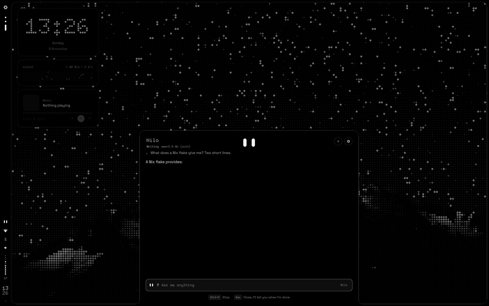
</p>

An assistant in the launcher, with a model that runs on this computer. Two white eyes
on black: asleep while the model is unloaded, awake as soon as you type, looking up
while they think and from side to side while they search. It answers, searches the web,
looks at this computer and opens apps, and, if you allow it, changes files, commits and
pushes in a repository and runs commands, each step confirmed by you first.

It is off by default. Preferences, System turns it on and chooses what runs the model
(CPU, Vulkan, ROCm or CUDA), applied with a rebuild; or, in the host:

```nix
nihil.nilo =
{
    enable = true;
    acceleration = "vulkan";   # or "cpu", "rocm", "cuda"
    integratedGpu = true;      # a laptop's Radeon or Intel GPU
};
```

That runs [Ollama](https://ollama.com) on `127.0.0.1` (`services.ollama`) and adds the
binds. The first time Nilo opens it introduces itself, shows how to call it, offers the
models that suit the RAM and asks what it may do.

| | |
|---|---|
| `SUPER + I`, the Copilot key | Open or close Nilo |
| `?` in the launcher | The same, typed: `?what's a flake` |
| Enter / Esc | Ask / close (an answer goes on) |
| `ctrl + c` | Stop the answer |
| `ctrl + n` | New conversation |
| The eyes in the bar | The model is in memory; click to open |

**Away from the launcher.** Close it while Nilo answers and the answer goes on. When it
ends, or when Nilo needs a confirmation, it sends a notification: the light runs round
the frame from the left, and instead of a popup a panel comes out of the bar next to the
eyes, with the question and the answer (or the command waiting for you). A click opens
the conversation; on its own it goes back after a few seconds, longer for long answers
(moving the pointer over it buys a few more). A confirmation stays half a minute, and
after that the eyes in the bar stay alert until you answer it. With do not disturb on,
only the panel's history keeps it.

**What it may do**, each one a switch in its settings (the gear): **Internet** — search
DuckDuckGo (through `ddgr`, or `nilo.searxng`) and read pages, never local addresses;
**This computer** — NixOS version and generation, memory, disk, battery; **Apps** — open
apps by name, and files, folders and web pages in whatever opens them; **Files** — read,
create and change files in one repository, never outside it or inside `.git`; **Git** —
`git add -A`, commit and push in that repository; **Terminal** — run commands with bash,
as you. The repository is NIHIL's own checkout until you choose another: the one `nihil
dev` builds from, else `~/nixos-config` or `~/Nihil-Shell`; the settings list the ones
under `~` (most recently used first) or take any path.

**Opening apps.** With Apps on, "abre zen" or "open zen and thunar" opens them at once,
without the model: the launcher's own search, when every name matches an app closely.
Anything more ("open zen and look for the weather") goes to Nilo as usual.

**Co-author.** Every commit Nilo makes carries
`Co-authored-by: Nilo <351236008+nilo-nihil@users.noreply.github.com>` (`nilo.coauthor`), and the card
shows it before you confirm. That is the noreply address of
[github.com/nilo-nihil](https://github.com/nilo-nihil), so GitHub draws Nilo's face next
to yours: [`assets/brand/nilo-avatar.png`](assets/brand/nilo-avatar.png), drawn by
`tools/brand.py`.

Files, Git and Terminal are off until you authorize them: the switch first says what it
allows and waits for "authorize" (or the same key again). Even then, every change to a
file shows its diff, every commit its files and message, and every command itself, where
it runs and why, and each waits for enter twice or a click. Commands that delete, touch
disks, rewrite git history, run as root or change the system come in a red card. Anything
with `sudo` opens in a kitty window, where you type the password; the rest run in the
background with their last lines under them, for two minutes at most. Choosing another
repository turns Files and Git off again.

<p align="center">
  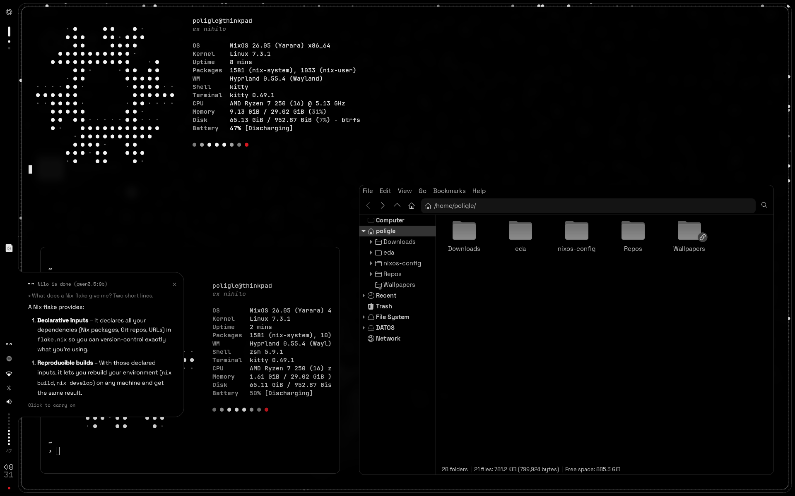
</p>

<sub>Closed while it thinks, Nilo says when it's done, out of the bar.</sub>

**Memory.** Ollama loads the model on the first question (Nilo starts loading it while
you type) and unloads it after the minutes chosen in the settings without questions: 5
by default. Asleep it takes no memory; Ollama itself stays as an idle service. Every model
runs where Preferences says (the CPU or the GPU), the big ones too. An integrated GPU
(`integratedGpu`) works in a window of the RAM, its GTT (about half of it), which the
screen needs as well: pick a model that leaves room in it, as the 9B does on a 32 GB
laptop and the 35B doesn't (ollama#17748). A model bigger than the machine's memory is
not loaded, and should memory run out, the kernel stops Ollama first, never the session.

**History.** A conversation lives in the agent while the shell runs: closing the launcher
keeps it, `ctrl + n` starts a new one, and nothing is written to disk. Nilo asks Ollama
for a window of `nilo.contextLength` tokens (16 384 by default; Qwen 3.5 goes up to 262 144
with more memory), and the oldest exchanges drop out once a conversation outgrows it.

**Models.** Qwen 3.5 by default; any Ollama model with tools works, and models pulled
with `ollama pull` show up in the list. With "choose the model for each question" on and a
smaller model downloaded, simple questions (short, one question, no code, nothing to
explain, write, run or commit) go to the smallest one and the rest to the one chosen; the
answer says which. With `nilo.loadedModels = 2` both stay in memory and switching is
instant; with 1, Ollama swaps them.

| Model | Download | RAM, roughly | Recommended from |
|---|---|---|---|
| `qwen3.5:0.8b` | 1.3 GB | 2 GB | Any |
| `qwen3.5:2b` | 2.7 GB | 3.5 GB | 8 GB |
| `qwen3.5:4b` | 3.4 GB | 5 GB | 12 GB |
| `qwen3.5:9b` | 6.6 GB | 8.5 GB | 20 GB |
| `qwen3.5:35b-a3b` | 22 GB | 25 GB | 56 GB |

The model, the switches, the minutes and "think before answering" apply at once and live
in `~/.local/state/nihil/nilo.json`; only the options above need a rebuild. The gear and
Preferences open each other: "Open Preferences" under the gear, and "Settings" beside
Nilo's switch in Preferences, System.

**What it knows.** [`home/nilo/nilo.md`](home/nilo/nilo.md) tells Nilo about this system
and the rules it works by: one step per tool call, each one authorized, look before
changing, nothing destructive unless asked. It goes into every prompt with only the
sections of the switches that are on. After it come your own notes,
`~/.config/nihil/nilo.md` (your notes, "Edit" in the gear), and, with Files or Git
authorized, the `NILO.md` of the repository if it has one.

The agent behind it is [`home/nilo/agent.py`](home/nilo/agent.py), standard-library
Python that the shell talks to over stdin/stdout. Its tests run against a fake Ollama:
`python3 -m unittest home/nilo/test_agent.py`.

If Ollama is down ("connection refused"), Nilo starts it (polkit lets wheel users start
`ollama.service` without a password) and otherwise shows what systemd and the journal say,
with a button to try again; systemd also restarts it if it stops on its own. Beyond that:
`systemctl status ollama`, `journalctl -u ollama -b`, `journalctl --user -u nihil-shell`
(the agent logs there) and `ollama ps`. The Copilot key sends `SUPER + SHIFT + F23` on
Linux 6.14 and later; xkb names F23 `XF86Assistant` or `XF86TouchpadOff` depending on its
version, so the bind uses its keycode, 201 (what `wev` shows).

---

## The phone as a deck

[NIHIL Launcher](https://github.com/poligle/Nihil-Launcher), the Android side of NIHIL, can be a deck for the computer:
its apps and web pages open here, its music plays and skips, its volume goes up and down,
its screen locks, its pointer moves and its clipboard goes either way, from the phone. That is all it can do: an app is one
the launcher shows, a page is `http` or `https`, the trackpad points and clicks as a touchpad
here would, and there is no way to run a command or read a file.

On the wrist, [NIHIL for Wear OS](https://github.com/poligle/Nihil-Wear) makes the watch one more deck: its
music, its volume on the bezel or the crown, its caffeine, night light and lock, from a watch face
in dots. It pairs over adb with the same code the QR holds. Preferences, Devices, **Install on a
watch** (or `nihil watch`) does it all from here, with nothing to clone or build: it finds the
watch's Wireless debugging on the network, so only the code the watch shows is typed, installs
the latest release with its face (checked against its SHA-256), hands the watch the invitation
and turns on its light on the edge. `nihil watch update` brings a newer release, `nihil watch
forget` unpairs it.

Preferences, Devices turns it on (a rebuild: the service, its port in the firewall and its
name on the local network) and pairs a phone with a QR. The QR holds the computer's
addresses, a one-time code (once, for five minutes) and the pin of its certificate: the
phone talks HTTPS only to the computer whose public key it was shown, and pairing gives it
a token of its own. The computer keeps only the token's hash, says when a phone pairs, and
lists the phones, each to forget. When its address changes, the phone finds it again by
mDNS (`_nihil-deck._tcp`).

On the phone the deck is one landscape screen in workspaces: the music and the volume in one;
the apps and the webs in the next, each with its icon; the trackpad in the last. Above them, this computer's caffeine,
night light and lock, with the desktop's own icons and lit while on. The apps' come from this
computer's icon theme; the webs' (`GET /v1/favicon`) are found by this computer on each site,
only at public addresses and kept a week, so the phone talks to no one else. The phone reads
the QR with a reader of its own, and sharing a web to *Open on the computer* opens it here. It
shows the cover of what plays, and keeps the dashboard's kanban in sync with its own, the
order of each column too: each side goes on when they are apart, and the next sync keeps what
both did (`docs/deck.md`).

The trackpad is a touchpad here (`GET /v1/trackpad`). The phone streams its fingers, every
sample with its time, and the deck writes them to a touchpad it makes with uinput (`NIHIL deck
trackpad`), as wide and tall as the phone's screen: libinput reads it as it reads the laptop's,
with the same settings, so a tap clicks, two fingers right-click and scroll, three
middle-click, a pinch zooms and the touchpad gestures run. The frames keep the phone's pace,
25 ms late, and the touchpad goes when the stream does. With the deck on, uinput is the
session's to use (a udev rule, `uaccess`), and libinput takes the touchpad as an external one,
so it works with the lid closed.

The service is [`home/deck/deck.py`](home/deck/deck.py), standard-library Python in the
user's session, which opens what it is asked through the shell (`nihil-ipc apps`,
`nihil-ipc media`) and the volume and lock as the keys do. The protocol, for the phone's
side, is in [`docs/deck.md`](docs/deck.md). Its tests run a real HTTPS server on
`127.0.0.1` with fake programs: `python3 -m unittest home/deck/test_deck.py`.

```bash
nihil-deck pair                       # the QR in the terminal, and its URI
nihil-deck devices                    # the phones paired; forget ID|all
systemctl --user status nihil-deck    # the service; journalctl --user -u nihil-deck
```

---

## Structure

```
Nihil-Shell/
├── flake.nix, flake.lock, home.nix   nihil.lib.mkSystem, the module, the ISO
├── theme/            Design system: tokens, i18n, fonts, wallpaper and boot renderers
│   ├── nihil.nix     palette, base16, fonts, frame geometry, motion
│   ├── i18n.nix      every string, per language
│   ├── dotmatrix.py  photo → LED matrix (wallpapers.nix runs it per output)
│   ├── plymouth.*    boot splash frames and theme
│   ├── qml.nix       Tokens.qml and Lang.qml, for the shell and the greeter
│   └── art/          LED maps of the NixOS snowflake (19 for fastfetch, 29 for boot)
├── modules/          system modules (default.nix gathers them; settings.nix reads settings.json)
├── installer/        the ISO and nihil-install
├── templates/        machine/: what the installer writes to /etc/nixos; example/: CI's machine
├── home/             Home Manager: shell/, nilo/ (Nilo's agent), deck/ (the phone's), hyprland, hyprlock, …
├── greeter/          the login screen, in Quickshell under cage (modules/greeter.nix)
├── sounds/           interface sounds (nihil/ is the NIHIL pack)
├── tools/            brand.py (logo, favicons, site images), sounds.py, snowflake.py
├── assets/brand/     logo and mark (SVG), social preview
├── docs/             the website, served by GitHub Pages from this folder; deck.md, the deck's protocol
├── .github/          release.yml: the ISO in Releases; update.yml: the inputs, every week;
│                     auto-pull-request.yml: a push to any other branch, as a pull request into nihil
└── wallpapers/       source photos, rendered as dots at build time
```

---

## Daily usage

```bash
nihil rebuild                  # apply /etc/nixos (alias nrebuild)
nihil update                   # the latest NIHIL, then rebuild (alias nupdate)
sudo nixos-rebuild build --flake /etc/nixos          # build without switching
sudo nix-collect-garbage --delete-older-than 7d     # (alias ngc)
```

`nh os switch` does the same as `nihil rebuild` and prints the package diff between
generations. Garbage collection also runs weekly on its own (`modules/nix.nix`), keeping
the generations of the last `generations.days` days; Preferences, Generations cleans now
too, and says what it freed.

To try changes to NIHIL before pushing them: `nihil dev ~/Nihil-Shell` rebuilds with that
checkout and keeps it, so `nihil rebuild` and Preferences use it too, until `nihil dev off`
or `nihil update`; `nihil version` says which NIHIL runs. Each rebuild takes a copy of the
checkout as it is, new files included, without `.git` (`/var/lib/nihil/dev-tree`): the
history stays out of the store. To build on a clone for good, point the machine's flake
at it (On a NixOS you already have, above).

### Keeping NIHIL current

NIHIL's `flake.lock` is the NixOS every machine runs: `nihil update` takes it from here.
Every Monday, [`.github/workflows/update.yml`](.github/workflows/update.yml) brings the
inputs up to date in a pull request, once a machine as the installer leaves it still
evaluates and the `nihil` command still builds (GitHub has to let Actions create pull
requests: Settings, Actions, General,
Workflow permissions, "Allow GitHub Actions to create and approve pull requests").
Nothing merges by itself: try its branch, `inputs`, with `nihil dev` on a checkout, then
merge it; that makes a new ISO, and `nihil update` takes it to each machine.
`nix flake update` does the same by hand.

A new NixOS release, every May and November, means moving `nixpkgs`, `home-manager` and
`stylix` in `flake.nix` to its branches together, before the one NIHIL follows reaches
its end of life. `home.stateVersion` in `home.nix` stays at `26.05`, the release NIHIL's
home started on, for every machine; `system.stateVersion` is each machine's own, in its
`local.nix`.

---

## Recovery

- **System won't boot:** pick an earlier generation from the boot menu (systemd-boot).
  It's a system-level restore point.
- **Something broke after applying or updating:** Preferences, Generations (or
  `nihil generations switch N`) goes back to an earlier generation without restarting,
  and "Boot it once" tries one at the next boot only, for what needs a restart (a kernel,
  a driver). Your settings stay as they are: the next apply builds from them again.
- **An update broke something:** boot the previous generation, then go back to the NIHIL
  you had: `/etc/nixos/flake.lock` holds the revision, so `git` on `/etc/nixos` (or a copy
  of the old lock) and `nihil rebuild` return to it.

---

## Technical details

- **Filesystem:** btrfs with subvolumes (`@`, `@home`, `@nix`, `@log`), zstd compression
  and `noatime`. Swap via zram.
- **Boot:** UEFI + systemd-boot with a systemd initrd and the NIHIL Plymouth theme
  (frames rendered at build time from `theme/art/snowflake-29.txt`). Its sound
  (`sounds/nihil/boot.wav`, the power-off notes going up) plays through ALSA once the
  sound card is up and while the splash is still there: PipeWire only starts with the
  session (`modules/boot-sound.nix`). The snowflake's LEDs wait unlit for it and switch on
  as it starts (`plymouth update --status=nihil-open`), the last of them with its last
  note; without it, they don't wait.
- **Login:** greetd + NIHIL's greeter (`greeter/shell.qml`, Quickshell) in cage on the last
  connected monitor, with the shell's tokens and strings. If it isn't up within ten seconds,
  ReGreet takes its place, themed by Stylix plus NIHIL CSS; `nihil.greeter = "regreet"`
  keeps ReGreet alone.
- **Hyprland in Lua:** the whole configuration is declared in Nix and Home Manager
  generates `hyprland.lua`. Under Lua, dispatchers are Lua too
  (`hl.dsp.focus({ workspace = "e+1" })`); Quickshell 0.3 detects it (`Hyprland.usingLua`).
  Stylix's Hyprland target is off: NIHIL sets the colours itself.
- **Quickshell and Hyprland focus:** drawers that take the keyboard use
  `WlrKeyboardFocus.OnDemand` together with a `HyprlandFocusGrab`. `Exclusive` would not
  work: Hyprland drops every focus grab when a layer becomes exclusive. The clipboard
  history takes none: while it is out its keys come through a Hyprland submap
  (`nihil-clipboard`) and the window keeps the keyboard; only a paste key without a
  modifier makes the frame `Exclusive` until it pastes.
- **Charger:** plugging it in lights the frame from the bottom and plays `charge`, three
  climbing notes (`tools/sounds.py`; the classic pack uses freedesktop's `power-plug`).
- **Battery:** the shell reads it through UPower, which `modules/nihil.nix` enables. At
  15, 10 and 5 % it sends a critical notification, once per threshold and discharge; each
  one replaces the last (`x-nihil-tag` hint) and plugging in the charger dismisses it.
- **Notifications:** a popup lasts what its app asks for (`notify-send -t`, at most 30 s)
  or 5 s, and critical ones 15 s; the pointer on a popup holds it, and every notification
  stays in the panel's history. Quickshell hands the timeout on in milliseconds, although
  its documentation says seconds.
- **Caffeine:** while it is on, every frame window holds a Wayland idle inhibitor, which
  hypridle honours: no dimming, no lock, no screen off, no suspend on its own. Closing the
  lid still suspends. It starts off with every session.
- **Lid:** closing it suspends the laptop, on the charger too, locked first. With another
  screen connected logind leaves it awake: the laptop's panel turns off and the session
  goes on on the other screen (`modules/hardware.nix`, and the lid binds in
  `home/hyprland.nix`). A machine changes it in `local.nix`, for instance
  `services.logind.settings.Login.HandleLidSwitchExternalPower = "lock";`.
- **Tasks:** the kanban lives in `~/.local/state/nihil/tasks.json`; edit it by hand and the
  board follows. Each card keeps when its text and its place (its column and its rank there)
  were last set: that is how it merges with the phone's.
- **Lock screen media:** [`home/lock/media.sh`](home/lock/media.sh) asks the players
  (playerctl) at most once a second and hyprlock's labels read the result; covers are
  drawn as dot matrices by [`home/lock/cover.py`](home/lock/cover.py) and cached in
  `$XDG_RUNTIME_DIR`. The cursor stays visible on the lock screen so the buttons can be
  clicked; the media keys work as well.
- **Pre-existing files:** if a file Home Manager wants to manage already exists, it is
  renamed to `*.hm-backup` instead of aborting the activation.
- **Own scripts:** packaged with `writeShellScriptBin` and explicit dependencies:
  `osd-volume`, `osd-brightness`, `osd-mic`, `mic-led-sync`, `lock-screen`, `power-off`,
  `nihil-wallpaper`, `nihil-ipc`.

---

## Credits

- [Caelestia](https://github.com/caelestia-dots/shell) for the frame-and-drawers idea.
- [Nothing](https://nothing.tech) for the design language that inspired the look. NIHIL
  is a personal project and is not affiliated with Nothing Technology.
- [Quickshell](https://quickshell.org), [Hyprland](https://hyprland.org),
  [Stylix](https://github.com/nix-community/stylix) and
  [Home Manager](https://github.com/nix-community/home-manager).
- The NixOS snowflake (by Tim Cuthbertson, CC BY 4.0) is drawn as LEDs from the
  Material Design Icons glyph shipped with Nerd Fonts.
- Fonts: Doto, Space Grotesk and Space Mono (SIL OFL 1.1), JetBrains Mono (SIL OFL 1.1).
  The website ships subsets of the first three, with their licence in `docs/assets/fonts`.
- Icons: [Colloid](https://github.com/vinceliuice/Colloid-icon-theme) by Vince Liuice
  (GPL-3.0), installed from nixpkgs.

Code, sounds and brand assets in this repository are MIT licensed (see `LICENSE`).

## Notes

Public repository: contains no secrets or credentials. User passwords are set with
`passwd`, and SSH keys and fingerprint data live outside the repository.
