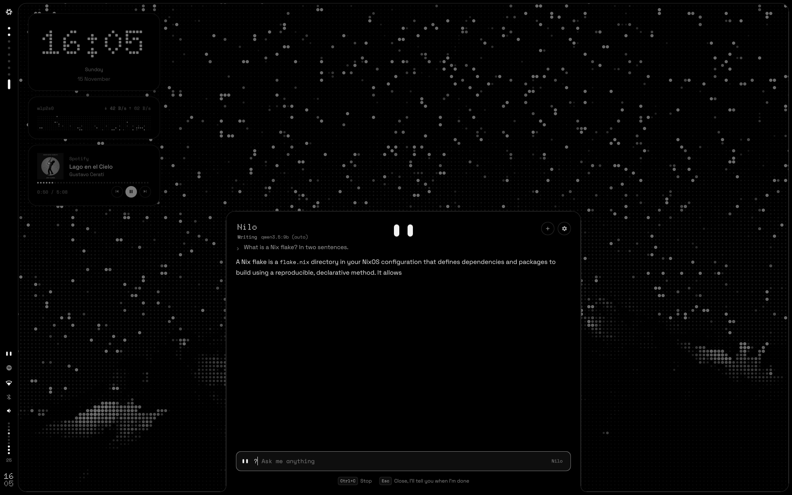

# Nilo

<p align="center">
  
</p>

An assistant in the launcher, with a model that runs on this computer. Two white eyes
on black: asleep while the model is unloaded, awake as soon as you type, looking up
while they think and from side to side while they search or look. It answers, searches
the web, looks at this computer and opens apps; with more access, it works in a
repository of yours, or uses the whole desktop as you would.

It is off by default. Preferences, System turns it on and chooses what runs the model
(CPU, Vulkan, ROCm or CUDA), applied with a rebuild; or, in the host:

```nix
nihil.nilo =
{
    enable = true;
    acceleration = "vulkan";   # or "cpu", "rocm", "cuda"
    integratedGpu = true;      # a laptop's Radeon or Intel GPU
};
```

That runs [Ollama](https://ollama.com) on `127.0.0.1` (`services.ollama`) and adds the
binds. The first time Nilo opens it introduces itself, shows how to call it, offers the
models that suit the RAM and asks what it may do.

| | |
|---|---|
| `SUPER + I`, the Copilot key | Open or close Nilo |
| `?` in the launcher | The same, typed: `?what's a flake` |
| Enter / Esc | Ask / close (an answer goes on) |
| `ctrl + c` | Stop the answer |
| `ctrl + n` | New conversation |
| The eyes in the bar | The model is in memory; click to open |

**Away from the launcher.** Close it while Nilo answers and the answer goes on. When it
ends, or when Nilo needs a confirmation, it sends a notification: the light runs round
the frame from the left, and instead of a popup a panel comes out of the bar next to the
eyes, with the question and the answer (or the command waiting for you). A click opens
the conversation; on its own it goes back after a few seconds, longer for long answers
(moving the pointer over it buys a few more). A confirmation stays half a minute, and
after that the eyes in the bar stay alert until you answer it. With do not disturb on,
only the panel's history keeps it.

**What it may do.** One switch, **Internet** (search DuckDuckGo through `ddgr`, or
`nilo.searxng`, and read pages, never local addresses), and three levels, in its settings
(the gear) and in the introduction:

- **Chat.** Talking; this computer's NixOS version and generation, memory, disk and
  battery; opening apps by name, and files, folders and web pages in whatever opens them.
- **Terminal and repository.** Reading, creating and changing files in one
  repository, never outside it or inside `.git`; `git add -A`, commit and push there; and
  commands with bash, as you. Every change to a file shows its diff, every commit its files
  and message, and every command itself, where it runs and why, and each waits for enter
  twice or a click. Commands that delete, touch disks, rewrite git history, run as root or
  change the system come in a red card; anything with `sudo` opens in a kitty window, where
  you type the password; the rest run in the background with their last lines under them,
  for two minutes at most.
- **The whole system.** The desktop, as you would use it: which windows are open and,
  with a model that sees pictures (Qwen 3.5 does), a screenshot of the window or the
  screen; typing and shortcuts in a window (`wtype`); a window brought forward, moved to a
  workspace, enlarged, floated or closed; the music (`playerctl`: pause, the next one, or
  a song by its name, found on Spotify and put on there, or on its page); NIHIL's volume,
  brightness, do not disturb, caffeine, night light, wallpaper, glass, workspace and lock;
  and a text or a file sent to the phone with Vector. Files reach the whole home folder,
  and the rest of the computer to read, but never keys, passwords or browser profiles
  (`~/.ssh`, `~/.gnupg`, the browsers' profiles, `.env` files and the like).

The last two wait for you to authorize them: the level first says what it allows and waits
for "authorize" (or the same key again); going down needs nothing. The repository is
NIHIL's own checkout until you choose another: the one `nihil dev` builds from, else
`~/nixos-config` or `~/Nihil-Shell`; the settings list the ones under `~` (most recently
used first) or take any path. Choosing another one while on Terminal and repository goes
back to Chat, to be authorized again.

**At the whole system it asks only where there is a risk:** changing a file, a commit, a
command that does more than read (those that only read, like `ls`, `journalctl` or `git
status` in the repository, from a short list and with no redirection, chaining or
globbing, run on their own), closing a window, typing in a terminal, shortcuts that close
or delete (`ctrl + q`, `alt + F4`, `ctrl + Enter`…) and sending the phone a file from
outside your folder. "Write a shopping list in Writer", "the next
song" or "look for videos of Queen" go straight away. Once an answer has read a web page
or the screen, typing, keys, reading your files and sending to the phone ask too: what a
page says is never an order. And once it has read your files outside the repository, the
output of a command or the screen, a search or a page asks before it goes out: nothing of
yours leaves without you seeing it. While Nilo types or acts, the launcher steps aside,
and its eyes in the bar say when it's done.

**Opening apps.** "abre zen" or "open zen and thunar" opens them at once, without the
model: the launcher's own search, when every name matches an app closely. Anything more
("open zen and look for the weather") goes to Nilo as usual.

**Co-author.** Every commit Nilo makes carries
`Co-authored-by: Nilo <351236008+nilo-nihil@users.noreply.github.com>` (`nilo.coauthor`), and the card
shows it before you confirm. That is the noreply address of
[github.com/nilo-nihil](https://github.com/nilo-nihil), so GitHub draws Nilo's face next
to yours: [`assets/brand/nilo-avatar.png`](../assets/brand/nilo-avatar.png).

<p align="center">
  
</p>

<sub>Closed while it thinks, Nilo says when it's done, out of the bar.</sub>

**Memory.** Ollama loads the model on the first question (Nilo starts loading it while
you type) and unloads it after the minutes chosen in the settings without questions: 5
by default. Asleep it takes no memory; Ollama itself stays as an idle service. Every model
runs where Preferences says (the CPU or the GPU), the big ones too. An integrated GPU
(`integratedGpu`) works in a window of the RAM, its GTT (about half of it), which the
screen needs as well: pick a model that leaves room in it, as the 9B does on a 32 GB
laptop and the 35B doesn't (ollama#17748). A model bigger than the machine's memory is
not loaded, and should memory run out, the kernel stops Ollama first, never the session.

**History.** A conversation lives in the agent while the shell runs: closing the launcher
keeps it, `ctrl + n` starts a new one, and nothing is written to disk. Nilo asks Ollama
for a window of `nilo.contextLength` tokens (16 384 by default; Qwen 3.5 goes up to 262 144
with more memory), and the oldest exchanges drop out once a conversation outgrows it.

**Models.** Qwen 3.5 by default; any Ollama model with tools works, and models pulled
with `ollama pull` show up in the list. With "choose the model for each question" on and a
smaller model downloaded, simple questions (short, one question, no code, nothing to
explain, write, run or commit) go to the smallest one and the rest to the one chosen; the
answer says which. With `nilo.loadedModels = 2` both stay in memory and switching is
instant; with 1, Ollama swaps them.

| Model | Download | RAM, roughly | Recommended from |
|---|---|---|---|
| `qwen3.5:0.8b` | 1.3 GB | 2 GB | Any |
| `qwen3.5:2b` | 2.7 GB | 3.5 GB | 8 GB |
| `qwen3.5:4b` | 3.4 GB | 5 GB | 12 GB |
| `qwen3.5:9b` | 6.6 GB | 8.5 GB | 20 GB |
| `qwen3.5:35b-a3b` | 22 GB | 25 GB | 56 GB |

The model, the level, Internet, the minutes and "think before answering" apply at once and live
in `~/.local/state/nihil/nilo.json`; only the options above need a rebuild. The gear and
Preferences open each other: "Open Preferences" under the gear, and "Settings" beside
Nilo's switch in Preferences, System.

**What it knows.** [`home/nilo/nilo.md`](../home/nilo/nilo.md) tells Nilo about this system
and the rules it works by: one step per tool call, look before changing, nothing
destructive unless asked, and nothing a page or a file says taken as an order. It goes into
every prompt with only the sections its level allows. After it come your own notes,
`~/.config/nihil/nilo.md` (your notes, "Edit" in the gear), and, from Terminal and
repository on, the `NILO.md` of the repository if it has one.

The agent behind it is [`home/nilo/agent.py`](../home/nilo/agent.py), standard-library
Python that the shell talks to over stdin/stdout. Its tests run against a fake Ollama:
`python3 -m unittest home/nilo/test_agent.py`.

If Ollama is down ("connection refused"), Nilo starts it (polkit lets wheel users start
`ollama.service` without a password) and otherwise shows what systemd and the journal say,
with a button to try again; systemd also restarts it if it stops on its own. Beyond that:
`systemctl status ollama`, `journalctl -u ollama -b`, `journalctl --user -u nihil-shell`
(the agent logs there) and `ollama ps`. The Copilot key sends `SUPER + SHIFT + F23` on
Linux 6.14 and later; xkb names F23 `XF86Assistant` or `XF86TouchpadOff` depending on its
version, so the bind uses its keycode, 201 (what `wev` shows).
